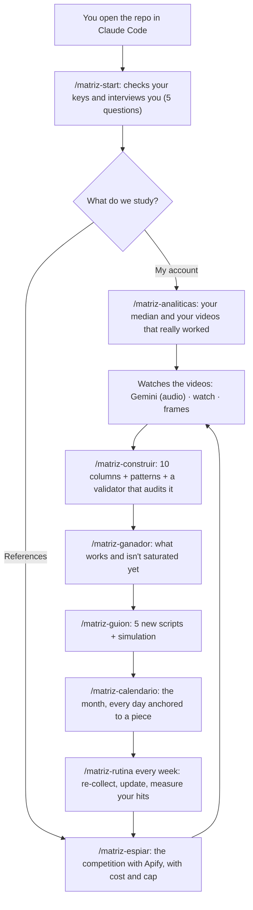

<p align="center">
  <picture>
    <source media="(prefers-color-scheme: dark) and (prefers-reduced-motion: reduce)" srcset="assets/hero-dark-static.svg">
    <source media="(prefers-color-scheme: light) and (prefers-reduced-motion: reduce)" srcset="assets/hero-light-static.svg">
    <source media="(prefers-color-scheme: dark)" srcset="assets/hero-dark.svg">
    <source media="(prefers-color-scheme: light)" srcset="assets/hero-light.svg">
    
  </picture>
</p>

<p align="center">
  <a href="#quick-start"></a>
  <a href="#costs"></a>
  <a href="LICENSE"></a>
  <a href="https://github.com/Hainrixz/matriz-viralidad/stargazers"></a>
  <a href="README.md"></a>
  <a href="README.en.md"></a>
</p>

<p align="center"><b>Tell it your niche. The agent finds what makes a video beat its median — and turns it into your next scripts.</b></p>

<p align="center">
Most people post and hope. Matriz Viralidad ("virality matrix") is an agent that runs inside Claude Code and does the work almost nobody does:
it pulls the most viral videos from your account or from creators you admire with <b>Apify</b>, <b>watches</b> them one by one, lays them out in a
<b>10-column matrix</b>, finds the pattern that repeats, writes five new scripts with that pattern and <b>simulates</b> them against what already happened.
No interface, no coding: you write in plain language and it works. The agent speaks your language (Spanish by default, English if you write in English).
</p>

<p align="center">
  <a href="#what-it-looks-like">What it looks like</a> ·
  <a href="#quick-start">Quick start</a> ·
  <a href="#the-cycle">The cycle</a> ·
  <a href="#the-matrix">The matrix</a> ·
  <a href="#commands">Commands</a> ·
  <a href="#how-it-watches-videos">Watching videos</a> ·
  <a href="#costs">Costs</a> ·
  <a href="#golden-rules">Golden rules</a> ·
  <a href="#security">Security</a> ·
  <a href="#works-with-the-rest-of-the-family">tododeia family</a> ·
  <a href="#faq">FAQ</a>
</p>

---

## What it looks like

A full session takes 20 to 40 minutes (mostly waiting for Apify and video analysis). Here is the opening, trimmed
(numbers are illustrative):

```text
Agent    Hi, I'm your content analyst. Checking your keys (without reading them)...
         ✓ APIFY_TOKEN present · ✓ ffmpeg · ✓ watch skill · ✗ GEMINI_API_KEY (optional)

Agent    Who do we study: your account, or 2–3 reference creators?
You      I'm just starting. I follow @creator_a and @creator_b, they do finance for freelancers.

Agent    Estimated cost: 40 reels each, 2 accounts → ≈ $0.21. Hard cap: $1.00.
         Run it?  →  Yes
Agent    Done. @creator_a median: 7,300 views (13 pieces). 3 pieces pass 1.5x.
         Which ones do I analyze? The top 3 cost ≈ $0.01 with audio, or $0 reading the burned-in captions.

Agent    Matrix built: 14 pieces, 3 patterns with enough evidence (≥5 pieces).
         The most repeated one above 1.5x: surprising number + short list, 25–35 s.
         What I DON'T know: posting time, thumbnail, editing and the algorithm's mood.
```

Nothing is downloaded or charged before you say "yes".

## Quick start

**What you need first:** [Claude Code](https://claude.com/claude-code) (desktop app or terminal), [Node 20 or newer](https://nodejs.org)
and a free [Apify](https://apify.com/sign-up) account (no card; about 5 USD of credit per month).
Optional: `ffmpeg` (read videos frame by frame), the [`watch`](https://github.com/bradautomates/claude-video) skill (watch video links) and a [Gemini](https://aistudio.google.com/apikey) key (hear the audio).
Tested on macOS; Linux should work the same; on Windows use Git Bash or WSL (not tested).

**1. Clone it and open it in Claude Code** (desktop app: *Code → open folder*; terminal: `claude` inside the folder):

```bash
git clone https://github.com/Hainrixz/matriz-viralidad && cd matriz-viralidad && claude
```

**2. Trust the folder.** Claude Code asks whether you trust it (the highlighted option starts on "No": pick "Yes, I trust this folder"). That turns on the auto-start and the project permissions:
they block reading your `.env`, ask for your OK before any run that costs money and don't let Claude edit `fuentes/`.

**3. Paste your Apify token yourself.** The agent never reads your keys: you paste them.

```bash
cp .env.example .env      # on Mac: open -e .env  (Finder hides dotfiles)
                          # paste your token: APIFY_TOKEN=your_token
```

The token is in *Apify → Settings → API & Integrations → Personal API token*. `.env` is in `.gitignore`: it never gets pushed.

**4. The agent starts on its own** and asks you five questions. If it didn't start, type `/matriz-start`.

> [!TIP]
> Want to see it work before spending or pasting anything? Using **made-up** sample data (it belongs to no real account):
> `node scripts/mediana.mjs examples/demo/fuentes/instagram-reels-cuenta_demo-posts-demo.json`

**As a plugin, no clone.** From any folder, inside Claude Code:

```text
/plugin marketplace add Hainrixz/matriz-viralidad
/plugin install matriz-viralidad@matriz-viralidad
/matriz-viralidad:matriz-start
```

In plugin mode the commands carry the `matriz-viralidad:` prefix. Your data and your `.env` live in the folder where you opened Claude Code, never inside the plugin.

> [!NOTE]
> Plugin mode doesn't auto-start and **doesn't bring the project's permission rules** (`.env` block, spend confirmation on `apify.mjs`).
> What does travel with the plugin is a hook that blocks Claude from reading your keys, and the agent's own rules still apply;
> but Claude Code will ask permission at more steps. If you can, clone the repo: it's the full experience.

## The cycle

The agent doesn't hand you a menu of five options: it follows a written cycle and tells you where you are and why.



## The matrix

Every video becomes **one row** of a ten-column table. The one that matters is `RENDIMIENTO` (performance):

```
RENDIMIENTO = piece views ÷ MEDIAN views of THAT account
```

Why the **median** and not the average: one viral outlier lifts the average and makes everything else look like a failure. And why **per account**:
500k views on a 10k-follower account are worth more than 600k on a 1M one. With the multiple (`3.2x` = triple what's normal *there*) you can compare accounts of any size.

| Column | What it is |
|---|---|
| `PIEZA` | Network + date + short title |
| `HOOK` | The first 1–2 sentences, **verbatim**, exactly as spoken |
| `TIPO DE HOOK` | direct question · surprising fact · contrast · confession · promise |
| `TEMA` | What it's about, in 3–5 words |
| `FORMATO` | talking to camera · tutorial · story · list · reaction |
| `DURACION` | In seconds, only if the data is real |
| `EMOCION` | curiosity · surprise · identification · urgency |
| `CTA` | What it asks at the end, or `ninguno` |
| `RENDIMIENTO` | Views ÷ that account's median: `> 1.5x` works · `< 0.7x` doesn't |
| `PATRON` | One line: why it did what it did |

(Column names and closed-list values stay in Spanish inside the files, so the validator can check them; the agent explains them in your language.)

Next to the table you get a second document, `patrones-de-viralidad.md`, with four sections: **what works** (patterns above 1.5x, pieces cited),
**what doesn't work**, **the virality pattern** (one paragraph joining hook, topic, format, duration and emotion) and **what we don't know** (posting time, thumbnail, editing
and the algorithm's mood aren't in the data, and the document says so).

With fewer than 5 pieces a pattern is reported but **not recommended**: `evidencia insuficiente` (insufficient evidence). Before delivery, a separate agent (`validador`) audits the matrix:
every hook verbatim, every value inside the closed lists, every median recomputed from the raw data.

## What you get

<table>
  <tr>
    <td width="50%" valign="top"><b>A spy with a spending cap</b><br>Instagram (reels and posts), TikTok, YouTube and X through Apify. Before each run you see the estimated cost; each run has a hard dollar cap and a log of the real spend.</td>
    <td width="50%" valign="top"><b>It watches the videos</b><br>Three paths: Gemini hears the audio, the <code>watch</code> skill downloads and transcribes links, and local frames read burned-in captions with no paid API. It tells you which one it used and what's lost.</td>
  </tr>
  <tr>
    <td valign="top"><b>An honest matrix</b><br>Medians, not averages. Whatever the scraper doesn't give stays <code>s/d</code> (n/a): never an invented zero. Every pattern cites its pieces.</td>
    <td valign="top"><b>What works and isn't saturated</b><br><code>/matriz-ganador</code> crosses how much a pattern is used against how well it performs: opportunity, saturation, dead habit and noise.</td>
  </tr>
  <tr>
    <td valign="top"><b>Scripts + simulation</b><br>Five new scripts with delivery notes. A script checks you didn't copy anyone's phrases, and each script is simulated: patterns it meets, signals for and against, estimate and confidence.</td>
    <td valign="top"><b>Community: what your audience asks for</b><br>Reads the comments on your most viral posts and separates what people <i>say</i> from what the agent <i>infers</i>, always with a verbatim quote.</td>
  </tr>
  <tr>
    <td valign="top"><b>An anchored calendar</b><br>Every row of the month carries the matrix piece that backs it. With no timing data, it says so instead of inventing "Tuesday at 6pm".</td>
    <td valign="top"><b>Weekly routine</b><br>Once a week: re-collects what's new with small caps, flags if a pattern changed, measures whether your simulations were right and plans your week.</td>
  </tr>
</table>

## Commands

| Command | What it does |
|---|---|
| `/matriz-start` | Checks your keys, asks the 5 questions, creates `perfil.json` and the folders. Start here. |
| `/matriz-analiticas` | Measures **your** accounts against their median: which of your videos really worked. |
| `/matriz-espiar <handle> <network>` | Pulls a public account and analyzes the videos you choose. |
| `/matriz-ver <link>` | Watches a single video and tells you how it's built (hook, structure, emotion, CTA). |
| `/matriz-construir` | The 10-column matrix and the patterns document, audited by the validator. |
| `/matriz-ganador` | Frequency × performance: what works and isn't saturated yet. |
| `/matriz-sentimiento` | What your audience thinks, doubts and asks for, with quotes. |
| `/matriz-guion` | 5 new scripts with the pattern, and their simulation. |
| `/matriz-calendario` | The month's calendar, every day anchored to a piece. |
| `/matriz-rutina` | The weekly community-manager routine. |
| `/matriz-doctor` | Diagnostics if something doesn't work. |

Natural order: `start` → `analiticas` or `espiar` → `construir` → `ganador` → `guion` → `calendario` → `rutina` every week.

## How it watches videos

| | Path A — Gemini | Path C — `watch` | Path B — frames |
|---|---|---|---|
| What it perceives | **the audio** | captions or audio (Whisper) + frames | only what is **seen** (burned-in captions) |
| Needs | `GEMINI_API_KEY` | the [`watch`](https://github.com/bradautomates/claude-video) skill | `ffmpeg` |
| Cost | ≈ 0.003–0.011 USD per video¹ | 0 if it has captions; Whisper via API costs whatever your provider charges | 0 API · ≈ 25k context tokens per video |
| Use it for | batches of competitor videos | a single link (`/matriz-ver`) | when nothing else is available |

¹ Measured on 6 real reels in August 2026; cost grows with duration.

`MATRIZ_ANALIZADOR` in `.env` (`auto`, `gemini` or `local`) picks the path. In `auto`, if Gemini is unreachable the agent falls back to frames **and tells you**
what's lost: the audio. A video with no burned-in captions leaves the hook as `s/d`: it never uses the caption as if it were the hook.

To install `watch` (optional): `/plugin marketplace add bradautomates/claude-video`, then `/plugin install watch@claude-video`.

## Costs

Little, and you see it **before** you spend it. Apify Free-plan prices, read from its public API on **2026-10-17** (paid plans are cheaper; prices change):

| What you pull | Actor | Price | Example |
|---|---|---|---|
| Instagram reels | `apify/instagram-reel-scraper` | 2.60 USD / 1,000 | 40 reels ≈ **0.10 USD** |
| Instagram posts and carousels | `apify/instagram-scraper` | 2.70 USD / 1,000 | 40 posts ≈ 0.11 USD |
| TikTok | `clockworks/tiktok-scraper` | 3.70 USD / 1,000 | 40 videos ≈ 0.15 USD |
| YouTube | `streamers/youtube-scraper` | 4.00 USD / 1,000 | 30 videos ≈ 0.12 USD |
| X (Twitter) | `apidojo/tweet-scraper` | 0.40 USD / 1,000 | 50 tweets ≈ 0.02 USD |

Each run adds a 0.001 USD start fee. **A full month** with 3 Instagram accounts (initial analysis of 40 reels each + 4 weekly routines of 15) is around **1 USD**,
Gemini included if you analyze a dozen videos. Your free Apify credit is about 5 USD per month.

- Apify transcripts are a paid add-on (≈ 0.048 USD per minute): **this agent doesn't turn them on**. The hook comes from the video analysis (Gemini, `watch` or frames).
- Some actors charge a per-run minimum; the real number shows up when the run ends (`node scripts/revisar.mjs gasto` sums the month).
- Default caps: initial analysis `--limite 40 --tope 1.00`; weekly routine `--limite 15 --tope 0.50`. The dollar cap is hard: if Apify rejects it, the script **stops** instead of running unbounded.

## Golden rules

1. **Never copy literal phrases.** The matrix gives you structure and technique (hook type, format, duration, emotion); the words are yours. `scripts/similitud.mjs` checks every script.
2. **Never let Claude invent metrics.** Whatever the scraper doesn't give is `s/d`. An `s/d` never turns into a zero or an average.
3. **Publish what scores low, too.** The estimate sets priority, not censorship. A simulation is an estimate based on past patterns, **not a prediction**.

## Security

- **Your keys aren't Claude's.** You paste them into `.env`. The scripts read them internally; Claude can only ask "is it set?" (`node scripts/revisar.mjs llaves`, which never shows the value).
  A hook (`scripts/guardia.mjs`) blocks any attempt to read `.env` or print a key, in plugin mode too.
- **The token travels in a header** (`Authorization`), not in the URL, and the scripts only look for `.env` in the project folder.
- **`fuentes/` is read-only**: it's the raw scraper output. In clone mode, the project permissions stop Claude from editing it.
- **Anything that spends money asks for your yes** in the same turn, with the estimated cost in view.
- **Public content only.** It doesn't enter private accounts, use your session or cookies, or download direct messages.
- Nothing is published or scheduled from here: the agent prepares; you publish.

## Works with the rest of the family

Matriz Viralidad ends where production begins. The scripts and the matrix are plain text files in your folder, so any other agent can read them:

| Tool | How it pairs with the matrix |
|---|---|
| [**Motion Architect**](https://github.com/Hainrixz/motion-architect) | Turn a winning script into a motion graphic: `/motion a 15 s reel using the script in guiones/<file>.md, vertical`. |
| [**Video Editor Architect**](https://github.com/Hainrixz/video-editor-architect) | Train it on your editing style and apply it to the video you record from the script. |
| [**Jarvis Architect**](https://github.com/Hainrixz/jarvis-architect) | Ask your Jarvis to run the weekly routine on schedule and send you the 5-line summary. |
| [**claude-ads**](https://github.com/Hainrixz/claude-ads) | A pattern that does well organically is a good candidate to test as an ad. |
| [**humanizalo**](https://github.com/Hainrixz/humanizalo) | Polish each script's caption and description so they sound like you, not like AI. |

These are workflow suggestions, not dependencies: Matriz Viralidad works on its own.

## Repo layout

```text
matriz-viralidad/
├── CLAUDE.md                 clone-mode rules (loaded automatically when the repo opens)
├── .claude/
│   ├── settings.json         startup agent, permissions and security hook
│   ├── agents/               matriz-viralidad (main) + espia, analista-video, matricero,
│   │                         sentimiento, calendarista, simulador, validador
│   └── skills/               the 11 skills (the commands) + matriz-metodologia (the method)
├── scripts/                  apify · mediana · gemini · fotogramas · descargar · revisar ·
│                             similitud · guardia · validar-repo   (Node, zero dependencies)
├── hooks/hooks.json          the same security hook for plugin mode
├── examples/demo/            MADE-UP sample data to try it without keys
├── tests/                    offline tests (npm test)
└── assets/                   hero and preview
```

Your data is created as you use it and is in `.gitignore`: `fuentes/` (raw), `videos/`, `transcripciones/`, `matriz/`, `guiones/`, `calendario/`, `perfil.json`.

## FAQ

**Do I need to code?** No. You write in plain language and the agent runs the scripts for you.

**Does it work in the Claude Code desktop app?** Yes, that's the main way to use it: open the cloned folder and talk. It also works in the terminal. If auto-start doesn't fire in your version, type `/matriz-start`.

**What if I'm just starting and have no content?** Pick "reference creators" in the first question: it studies 2–3 accounts in your niche and builds the matrix from them.

**Why doesn't it use Apify's transcripts?** Today they're a paid per-minute add-on. With Gemini, `watch` or frames the hook comes out the same at almost no cost.

**A video won't download (403/404).** Instagram and TikTok video addresses expire within minutes. Run `/matriz-espiar` again and download right away.

**Can I use the Apify MCP instead of the scripts?** You can (`claude mcp add --transport http apify https://mcp.apify.com`), but the scripts enforce spend caps and save the raw data deterministically; that's why they're the default.

**Something's not working.** `/matriz-doctor` checks your setup and tells you what to fix.

## Legal notice

This system analyzes **public content only**: posts and comments anyone can see without logging in. What you download stays on your computer and is for **studying patterns**,
not for copying or republishing anyone's work. The content still belongs to its authors. Respect each network's terms of service and your country's personal-data laws: how you use it is your responsibility.
Simulations are estimates over past patterns, not guarantees. Apify prices change: check [apify.com/pricing](https://apify.com/pricing).

## About

Based on the [viral content matrix guide](https://www.tododeia.com/community/matriz-viral) from the **tododeia** community. Built by [Enrique Rocha](https://github.com/Hainrixz) (**@soyenriquerocha**), with Claude Code.
[MIT](LICENSE) license. Want to improve it? Read [CONTRIBUTING.md](CONTRIBUTING.md). Found a security issue? Read [SECURITY.md](SECURITY.md).
