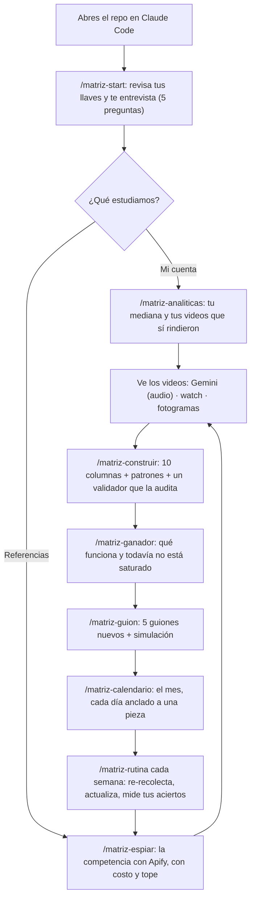

<p align="center">
  <picture>
    <source media="(prefers-color-scheme: dark) and (prefers-reduced-motion: reduce)" srcset="assets/hero-dark-static.svg">
    <source media="(prefers-color-scheme: light) and (prefers-reduced-motion: reduce)" srcset="assets/hero-light-static.svg">
    <source media="(prefers-color-scheme: dark)" srcset="assets/hero-dark.svg">
    <source media="(prefers-color-scheme: light)" srcset="assets/hero-light.svg">
    
  </picture>
</p>

<p align="center">
  <a href="#inicio-rápido"></a>
  <a href="#cuánto-cuesta"></a>
  <a href="LICENSE"></a>
  <a href="https://github.com/Hainrixz/matriz-viralidad/stargazers"></a>
  <a href="README.md"></a>
  <a href="README.en.md"></a>
</p>

<p align="center"><b>Dile tu nicho. El agente descubre qué hace que un video rompa su mediana — y lo convierte en tus próximos guiones.</b></p>

<p align="center">
Mucha gente publica "a ver qué pega". Matriz Viralidad es un agente que corre dentro de Claude Code y hace el trabajo que casi nadie hace:
trae los videos más virales de tu cuenta o de los creadores que admiras con <b>Apify</b>, los <b>ve</b> uno por uno, los ordena en una
<b>matriz de 10 columnas</b>, encuentra el patrón que se repite, escribe cinco guiones nuevos con ese patrón y los <b>simula</b> contra lo que ya pasó.
Sin interfaz, sin programar: le escribes en español y trabaja.
</p>

<p align="center">
  <a href="#cómo-se-ve">Cómo se ve</a> ·
  <a href="#inicio-rápido">Inicio rápido</a> ·
  <a href="#el-ciclo">El ciclo</a> ·
  <a href="#la-matriz">La matriz</a> ·
  <a href="#comandos">Comandos</a> ·
  <a href="#cómo-ve-los-videos">Ver videos</a> ·
  <a href="#cuánto-cuesta">Costos</a> ·
  <a href="#reglas-de-oro">Reglas de oro</a> ·
  <a href="#seguridad">Seguridad</a> ·
  <a href="#se-conecta-con-el-resto-de-la-familia">Familia tododeia</a> ·
  <a href="#preguntas-frecuentes">FAQ</a>
</p>

---

## Cómo se ve

Una sesión real de punta a punta toma entre 20 y 40 minutos (casi todo es espera de Apify y análisis de video). Así empieza, recortada
(los números son un ejemplo ilustrativo):

```text
Agente   Hola, soy tu analista de contenido. Reviso tus llaves (sin leerlas)...
         ✓ APIFY_TOKEN presente · ✓ ffmpeg · ✓ skill watch · ✗ GEMINI_API_KEY (opcional)

Agente   ¿A quién estudiamos: tu cuenta, o 2–3 creadores de referencia?
Tú       Apenas empiezo. Sigo a @creadora_a y @creador_b, hacen finanzas para freelancers.

Agente   Costo estimado: 40 reels de cada una, 2 cuentas → ≈ $0.21. Tope duro: $1.00.
         ¿Corro?  →  Sí
Agente   Listo. Mediana de @creadora_a: 7,300 views (13 piezas). 3 piezas pasan 1.5x.
         ¿Cuáles analizo? Las 3 más virales cuestan ≈ $0.01 con audio, o $0 leyendo el subtítulo.

Agente   Matriz construida: 14 piezas, 3 patrones con evidencia suficiente (≥5 piezas).
         El que más se repite en lo que supera 1.5x: dato que sorprende + lista corta, 25–35 s.
         Lo que NO sé: hora de publicación, miniatura, edición y el humor del algoritmo.
```

Nada se descarga ni se gasta antes de que digas "sí".

## Inicio rápido

**Lo que necesitas antes:** [Claude Code](https://claude.com/claude-code) (la app de escritorio, o la terminal), [Node 20 o más nuevo](https://nodejs.org)
y una cuenta gratis de [Apify](https://apify.com/sign-up) (sin tarjeta; trae unos 5 USD de crédito al mes).
Opcionales: `ffmpeg` (leer videos por fotogramas), la skill [`watch`](https://github.com/bradautomates/claude-video) (ver links de video) y una llave de [Gemini](https://aistudio.google.com/apikey) (oír el audio).
Probado en macOS; en Linux debería funcionar igual; en Windows usa Git Bash o WSL (no lo he probado).

**1. Clónalo y ábrelo en Claude Code** (app de escritorio: *Code → abrir carpeta*; terminal: `claude` dentro de la carpeta):

```bash
git clone https://github.com/Hainrixz/matriz-viralidad && cd matriz-viralidad && claude
```

**2. Confía en la carpeta.** Claude Code te pregunta si confías en ella (la opción resaltada empieza en "No": elige "Sí, confío"). Eso activa el arranque automático
y los permisos del proyecto: bloquean leer tu `.env`, piden tu OK antes de cualquier corrida que cueste dinero y no dejan editar `fuentes/`.

**3. Pega tu token de Apify, tú mismo.** El agente nunca lee tus llaves: las pegas tú.

```bash
cp .env.example .env      # en Mac: open -e .env  (el Finder oculta los archivos con punto)
                          # pega tu token: APIFY_TOKEN=tu_token
```

El token sale de *Apify → Settings → API & Integrations → Personal API token*. `.env` está en `.gitignore`: no se sube.

**4. El agente arranca solo** y te hace cinco preguntas. Si no arrancó, escribe `/matriz-start`.

> [!TIP]
> ¿Quieres ver cómo funciona antes de gastar o pegar nada? Con datos de ejemplo **inventados** (no son de ninguna cuenta real):
> `node scripts/mediana.mjs examples/demo/fuentes/instagram-reels-cuenta_demo-posts-demo.json`

**Como plugin, sin clonar.** Desde cualquier carpeta, dentro de Claude Code:

```text
/plugin marketplace add Hainrixz/matriz-viralidad
/plugin install matriz-viralidad@matriz-viralidad
/matriz-viralidad:matriz-start
```

En modo plugin los comandos llevan el prefijo `matriz-viralidad:`. Tus datos y tu `.env` viven en la carpeta donde abriste Claude Code, nunca dentro del plugin.

> [!NOTE]
> El modo plugin no arranca solo y **no trae las reglas de permisos** del proyecto (bloqueo del `.env`, confirmación de gasto en `apify.mjs`).
> Lo que sí viaja con el plugin es un hook que bloquea que Claude lea tus llaves, y las reglas del agente siguen aplicando;
> pero Claude Code te pedirá permiso en más pasos. Si puedes, clona el repo: es la experiencia completa.

## El ciclo

El agente no te da un menú de cinco opciones: sigue un ciclo escrito y te dice en qué paso vas y por qué.



## La matriz

Cada video se vuelve **una fila** de una tabla con diez columnas. La que importa es `RENDIMIENTO`:

```
RENDIMIENTO = views de la pieza ÷ MEDIANA de views de ESA cuenta
```

Por qué la **mediana** y no el promedio: un solo video que explota sube el promedio y hace que todo lo demás parezca un fracaso. Y por qué **por cuenta**:
500k views en una cuenta de 10k seguidores valen más que 600k en una de 1M. Con el múltiplo (`3.2x` = el triple de lo normal *ahí*) puedes comparar cuentas de cualquier tamaño.

| Columna | Qué es |
|---|---|
| `PIEZA` | Red + fecha + título corto |
| `HOOK` | Las primeras 1–2 frases **literales**, tal como se dicen |
| `TIPO DE HOOK` | pregunta directa · dato sorprendente · contraste · confesión · promesa |
| `TEMA` | De qué habla, en 3–5 palabras |
| `FORMATO` | habla a cámara · tutorial · historia · lista · reacción |
| `DURACION` | En segundos, solo si el dato es real |
| `EMOCION` | curiosidad · sorpresa · identificación · urgencia |
| `CTA` | Qué pide al final, o `ninguno` |
| `RENDIMIENTO` | Views ÷ mediana de esa cuenta: `> 1.5x` funciona · `< 0.7x` no funciona |
| `PATRON` | En una línea: por qué rindió como rindió |

Junto a la tabla sale un segundo documento, `patrones-de-viralidad.md`, con cuatro secciones: **qué funciona** (patrones por encima de 1.5x, con las piezas citadas),
**qué no funciona**, **el patrón de viralidad** (un párrafo que junta hook, tema, formato, duración y emoción) y **lo que no sabemos** (hora de publicación, miniatura, edición
y el humor del algoritmo no están en los datos, y el documento lo dice).

Con menos de 5 piezas, un patrón se reporta pero **no se recomienda**: `evidencia insuficiente`. Antes de entregarla, un agente aparte (`validador`) audita la matriz:
que cada hook sea literal, que cada valor esté en las listas cerradas y que las medianas se recalculen desde los datos crudos.

## Qué obtienes

<table>
  <tr>
    <td width="50%" valign="top"><b>Espía con tope de gasto</b><br>Instagram (reels y posts), TikTok, YouTube y X con Apify. Antes de cada corrida ves el costo estimado; cada una lleva tope duro en dólares y un registro del gasto real.</td>
    <td width="50%" valign="top"><b>Ve los videos</b><br>Tres caminos: Gemini oye el audio, la skill <code>watch</code> baja y transcribe links, y los fotogramas locales leen el subtítulo sin API de pago. Te dice cuál usó y qué se pierde.</td>
  </tr>
  <tr>
    <td valign="top"><b>Matriz honesta</b><br>Medianas, no promedios. Lo que el scraper no da se queda en <code>s/d</code>: nunca un cero inventado. Cada patrón cita sus piezas.</td>
    <td valign="top"><b>Lo que funciona y no se ha saturado</b><br><code>/matriz-ganador</code> cruza cuánto se usa un patrón contra cuánto rinde: oportunidad, saturación, costumbre muerta y ruido.</td>
  </tr>
  <tr>
    <td valign="top"><b>Guiones + simulación</b><br>Cinco guiones nuevos con notas de entrega. Un script verifica que no copiaste frases de nadie, y cada guion se simula: patrones que cumple, señales a favor y en contra, estimación y confianza.</td>
    <td valign="top"><b>Comunidad: qué pide tu audiencia</b><br>Lee los comentarios de los posts más virales y separa lo que la gente <i>dice</i> de lo que el agente <i>infiere</i>, siempre con cita textual.</td>
  </tr>
  <tr>
    <td valign="top"><b>Calendario con ancla</b><br>Cada fila del mes lleva la pieza de la matriz que la respalda. Si no hay dato de horario, lo dice en vez de inventar "el martes a las 6pm".</td>
    <td valign="top"><b>Rutina semanal</b><br>Una vez por semana: re-recolecta lo nuevo con topes chicos, avisa si un patrón cambió, mide si tus simulaciones acertaron y arma tu semana.</td>
  </tr>
</table>

## Comandos

| Comando | Qué hace |
|---|---|
| `/matriz-start` | Revisa tus llaves, te hace las 5 preguntas, crea `perfil.json` y las carpetas. Por aquí se empieza. |
| `/matriz-analiticas` | Mide **tus** cuentas contra su mediana: qué videos tuyos rindieron de verdad. |
| `/matriz-espiar <handle> <red>` | Trae una cuenta pública y analiza los videos que tú elijas. |
| `/matriz-ver <link>` | Mira un video suelto y te dice cómo está hecho (hook, estructura, emoción, CTA). |
| `/matriz-construir` | La matriz de 10 columnas y el documento de patrones, auditados por el validador. |
| `/matriz-ganador` | Frecuencia × rendimiento: lo que funciona y todavía no satura. |
| `/matriz-sentimiento` | Qué piensa, duda y pide tu audiencia, con citas. |
| `/matriz-guion` | 5 guiones nuevos con el patrón, y su simulación. |
| `/matriz-calendario` | El calendario del mes, cada día anclado a una pieza. |
| `/matriz-rutina` | La rutina semanal de community manager. |
| `/matriz-doctor` | Diagnóstico si algo no funciona. |

El orden natural: `start` → `analiticas` o `espiar` → `construir` → `ganador` → `guion` → `calendario` → `rutina` cada semana.

## Cómo ve los videos

| | Camino A — Gemini | Camino C — `watch` | Camino B — fotogramas |
|---|---|---|---|
| Qué percibe | **el audio** | subtítulos o audio (Whisper) + fotogramas | solo lo que se **ve** (subtítulo quemado) |
| Necesita | `GEMINI_API_KEY` | la skill [`watch`](https://github.com/bradautomates/claude-video) | `ffmpeg` |
| Costo | ≈ 0.003–0.011 USD por video¹ | 0 si trae subtítulos; Whisper por API cuesta según tu proveedor | 0 de API · ≈ 25 mil tokens de contexto por video |
| Úsalo para | lotes de la competencia | un link suelto (`/matriz-ver`) | cuando no hay nada más |

¹ Medido sobre 6 reels reales en agosto de 2026; el costo sube con la duración.

`MATRIZ_ANALIZADOR` en el `.env` (`auto`, `gemini` o `local`) decide el camino. En `auto`, si Gemini es inalcanzable el agente cae a fotogramas **y te lo avisa**
con lo que se pierde: el audio. Un video sin subtítulo quemado deja el hook en `s/d`: nunca usa el caption como si fuera el hook.

Para instalar `watch` (opcional): `/plugin marketplace add bradautomates/claude-video` y luego `/plugin install watch@claude-video`.

## Cuánto cuesta

Poco, y lo ves **antes** de gastarlo. Precios del plan Free de Apify, consultados a su API pública el **2026-10-17** (los planes de pago son más baratos; cambian con el tiempo):

| Qué traes | Actor | Precio | Ejemplo |
|---|---|---|---|
| Reels de Instagram | `apify/instagram-reel-scraper` | 2.60 USD / 1,000 | 40 reels ≈ **0.10 USD** |
| Posts y carruseles de Instagram | `apify/instagram-scraper` | 2.70 USD / 1,000 | 40 posts ≈ 0.11 USD |
| TikTok | `clockworks/tiktok-scraper` | 3.70 USD / 1,000 | 40 videos ≈ 0.15 USD |
| YouTube | `streamers/youtube-scraper` | 4.00 USD / 1,000 | 30 videos ≈ 0.12 USD |
| X (Twitter) | `apidojo/tweet-scraper` | 0.40 USD / 1,000 | 50 tuits ≈ 0.02 USD |

Cada corrida suma 0.001 USD de arranque. **Un mes completo** con 3 cuentas de Instagram (análisis inicial de 40 reels cada una + 4 rutinas semanales de 15) ronda **1 USD**,
Gemini incluido si analizas una docena de videos. Tu crédito gratis de Apify es de unos 5 USD al mes.

- Las transcripciones de Apify son un add-on de pago (≈ 0.048 USD por minuto): **este agente no las activa**. El hook sale del análisis del video (Gemini, `watch` o fotogramas).
- Algunos actores cobran un mínimo por corrida; el número real sale al terminar (`node scripts/revisar.mjs gasto` suma el mes).
- Topes por defecto: análisis inicial `--limite 40 --tope 1.00`; rutina semanal `--limite 15 --tope 0.50`. El tope en dólares es duro: si Apify lo rechaza, el script **se detiene** en vez de correr sin freno.

## Reglas de oro

1. **Nunca copies frases literales.** La matriz te da estructura y técnica (tipo de hook, formato, duración, emoción); las palabras son tuyas. `scripts/similitud.mjs` lo comprueba en cada guion.
2. **Nunca dejes que Claude invente métricas.** Lo que el scraper no da es `s/d`. Un `s/d` jamás se convierte en cero ni en promedio.
3. **Publica también lo que puntúe bajo.** La estimación ordena prioridades, no censura. Una simulación es una estimación basada en patrones pasados, **no una predicción**.

## Seguridad

- **Tus llaves no son de Claude.** Las pegas tú en `.env`. Los scripts las leen por dentro; Claude solo puede preguntar "¿está o no está?" (`node scripts/revisar.mjs llaves`, que nunca muestra el valor).
  Un hook (`scripts/guardia.mjs`) bloquea cualquier intento de leer el `.env` o de imprimir una llave, también en modo plugin.
- **El token viaja en un header** (`Authorization`), no en la URL, y los scripts solo buscan el `.env` en la carpeta del proyecto.
- **`fuentes/` es de solo lectura**: es el crudo tal cual salió del scraper. En modo clon, los permisos del proyecto impiden que Claude lo edite.
- **Todo lo que gasta pide tu sí** en el mismo turno, con el costo estimado a la vista.
- **Solo contenido público.** No entra a cuentas privadas, no usa tu sesión ni tus cookies, no baja mensajes directos.
- Nada se publica ni se programa desde aquí: el agente prepara; tú publicas.

## Se conecta con el resto de la familia

Matriz Viralidad termina donde empieza la producción. Los guiones y la matriz son archivos de texto en tu carpeta, así que cualquier otro agente los puede leer:

| Herramienta | Cómo se junta con la matriz |
|---|---|
| [**Motion Architect**](https://github.com/Hainrixz/motion-architect) | Convierte un guion ganador en un motion graphic: `/motion un reel de 15 s con el guion de guiones/<archivo>.md, formato vertical`. |
| [**Video Editor Architect**](https://github.com/Hainrixz/video-editor-architect) | Entrénalo con tu estilo de edición y aplícalo al video que grabes con el guion. |
| [**Jarvis Architect**](https://github.com/Hainrixz/jarvis-architect) | Pídele a tu Jarvis que corra la rutina semanal a su hora y te mande el resumen de 5 líneas. |
| [**claude-ads**](https://github.com/Hainrixz/claude-ads) | Un patrón con rendimiento alto en orgánico es un buen candidato para probar como anuncio. |
| [**humanizalo**](https://github.com/Hainrixz/humanizalo) | Pule el caption y la descripción de cada guion para que suenen a ti, no a IA. |

Son sugerencias de flujo, no dependencias: Matriz Viralidad funciona sola.

## Estructura del repo

```text
matriz-viralidad/
├── CLAUDE.md                 reglas del modo clon (se carga solo al abrir el repo)
├── .claude/
│   ├── settings.json         agente de arranque, permisos y hook de seguridad
│   ├── agents/               matriz-viralidad (principal) + espia, analista-video, matricero,
│   │                         sentimiento, calendarista, simulador, validador
│   └── skills/               las 11 skills (los comandos) + matriz-metodologia (el método)
├── scripts/                  apify · mediana · gemini · fotogramas · descargar · revisar ·
│                             similitud · guardia · validar-repo   (Node, sin dependencias)
├── hooks/hooks.json          el mismo hook de seguridad para el modo plugin
├── examples/demo/            datos de ejemplo INVENTADOS para probar sin llaves
├── tests/                    pruebas offline (npm test)
└── assets/                   hero y vista previa
```

Tus datos se crean al usarlo y están en `.gitignore`: `fuentes/` (crudo), `videos/`, `transcripciones/`, `matriz/`, `guiones/`, `calendario/`, `perfil.json`.

## Preguntas frecuentes

**¿Necesito saber programar?** No. Escribes en español y el agente corre los scripts por ti.

**¿Funciona en la app de escritorio de Claude Code?** Sí, es la forma principal de uso: abre la carpeta clonada y habla. También funciona en la terminal. Si el arranque automático no se dispara en tu versión, escribe `/matriz-start`.

**¿Y si apenas empiezo y no tengo contenido?** Elige "creadores de referencia" en la primera pregunta: estudia a 2–3 cuentas de tu nicho y construye la matriz con ellas.

**¿Por qué no usa las transcripciones de Apify?** Hoy son un add-on de pago por minuto. Con Gemini, `watch` o fotogramas el hook sale igual y casi sin costo.

**Me dice que un video no se descarga (403/404).** Las direcciones de video de Instagram y TikTok caducan en minutos. Vuelve a correr `/matriz-espiar` y descarga enseguida.

**¿Puedo usar el MCP de Apify en vez de los scripts?** Puedes (`claude mcp add --transport http apify https://mcp.apify.com`), pero los scripts hacen cumplir los topes de gasto y guardan el crudo de forma determinista; por eso son el camino por defecto.

**Algo no funciona.** `/matriz-doctor` revisa tu instalación y te dice qué arreglar.

## Aviso legal

Este sistema analiza **únicamente contenido público**: publicaciones y comentarios que cualquiera puede ver sin iniciar sesión. Lo que bajas se queda en tu computadora y es para **estudiar patrones**,
no para copiar ni republicar el trabajo de nadie. El contenido sigue siendo de sus autores. Respeta los términos de servicio de cada red y las leyes de datos personales de tu país: el uso es tu responsabilidad.
Las simulaciones son estimaciones sobre patrones pasados, no garantías de resultados. Los precios de Apify cambian: verifica en [apify.com/pricing](https://apify.com/pricing).

## Acerca de

Basado en la guía [Matriz de contenido viral](https://www.tododeia.com/community/matriz-viral) de la comunidad **tododeia**. Construido por [Enrique Rocha](https://github.com/Hainrixz) (**@soyenriquerocha**), con Claude Code.
Licencia [MIT](LICENSE). ¿Quieres mejorarlo? Lee [CONTRIBUTING.md](CONTRIBUTING.md). ¿Encontraste un problema de seguridad? Lee [SECURITY.md](SECURITY.md).
